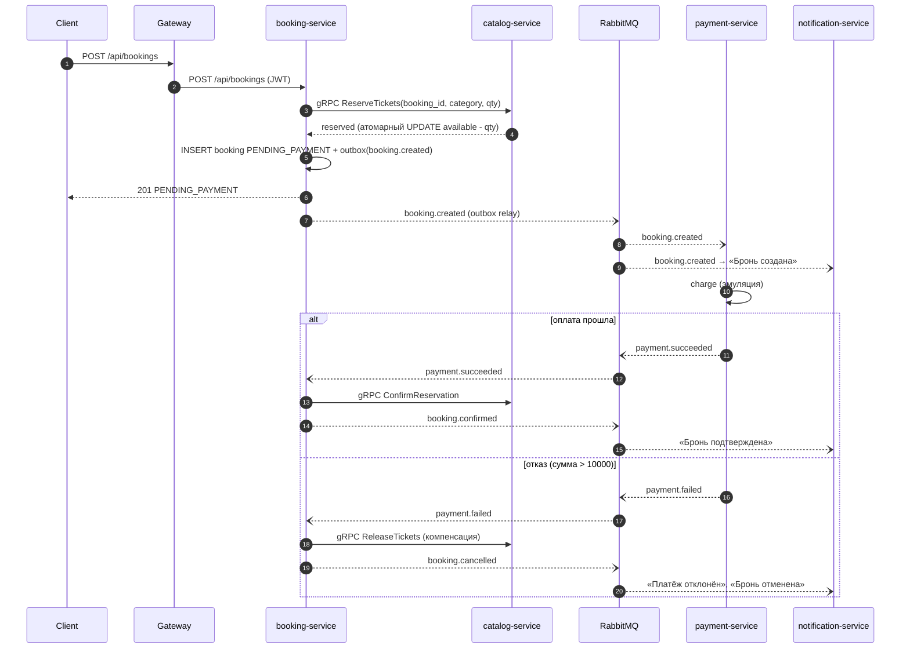

# Ticketing — микросервисная система бронирования билетов

Лабораторная работа №2 (PAD): backend на микросервисной архитектуре.
Предметная область — онлайн-продажа билетов на мероприятия (концерты, театр, спорт).

**6 бизнес-микросервисов** + API Gateway, у каждого сервиса своя БД. Сервисы общаются синхронно (REST, gRPC) и асинхронно (RabbitMQ). Есть мониторинг (Prometheus + Grafana), простой веб-интерфейс и CI.

---

## Содержание
1. [Архитектура](#архитектура)
2. [Сервисы и их ответственность](#сервисы-и-их-ответственность)
3. [Взаимодействие сервисов](#взаимодействие-сервисов)
4. [Технологический стек и обоснование](#технологический-стек-и-обоснование)
5. [Запуск](#запуск)
6. [API (основные endpoint'ы)](#api-основные-endpointы)
7. [Аутентификация и авторизация](#аутентификация-и-авторизация)
8. [Обработка ошибок](#обработка-ошибок)
9. [Логирование](#логирование)
10. [Мониторинг](#мониторинг)
11. [Тестирование](#тестирование)
12. [Структура проекта](#структура-проекта)

Подробности по проектным решениям (сага, outbox, идемпотентность, отказоустойчивость): [docs/architecture.md](docs/architecture.md).

---

## Архитектура

```mermaid
flowchart TB
    client([Browser / curl]) --> fe[Frontend<br/>nginx :3000]
    client --> gw
    fe --> gw[API Gateway<br/>FastAPI :8080]
    gw --- redis[(Redis<br/>rate limit)]

    gw -->|REST| auth[auth-service]
    gw -->|REST| user[user-service]
    gw -->|REST| catalog[catalog-service]
    gw -->|REST| booking[booking-service]
    gw -->|REST| payment[payment-service]
    gw -->|REST| notif[notification-service]

    booking -->|gRPC :50051<br/>Reserve / Confirm / Release| catalog

    auth --- authdb[(PostgreSQL<br/>auth)]
    user --- userdb[(PostgreSQL<br/>users)]
    catalog --- catdb[(PostgreSQL<br/>catalog)]
    booking --- bookdb[(PostgreSQL<br/>booking)]
    payment --- paydb[(PostgreSQL<br/>payment)]
    notif --- mongo[(MongoDB<br/>notifications)]

    auth -. user.registered .-> mq{{RabbitMQ<br/>ticketing.events}}
    booking -. booking.* .-> mq
    payment -. payment.* .-> mq
    mq -. user.* .-> user
    mq -. payment.* .-> booking
    mq -. booking.* .-> payment
    mq -. "user.* / booking.* / payment.*" .-> notif
```

Схема в текстовом виде:

```
                         ┌──────────────┐      ┌────────┐
 Browser ──► Frontend ──►│ API Gateway  │──────│ Redis  │  (rate limiting)
                         └──────┬───────┘      └────────┘
          REST (JWT, request-id, timeouts, retry, circuit breaker)
   ┌──────────┬──────────┬──────┴────┬───────────┬──────────────┐
   ▼          ▼          ▼           ▼           ▼              ▼
┌──────┐  ┌──────┐  ┌─────────┐ ┌─────────┐ ┌─────────┐ ┌──────────────┐
│ auth │  │ user │  │ catalog │◄│ booking │ │ payment │ │ notification │
└──┬───┘  └──┬───┘  └────┬────┘ └────┬────┘ └────┬────┘ └──────┬───────┘
   │PG       │PG    gRPC │PG         │PG         │PG           │Mongo
   │         │           │           │           │             │
   └─────────┴───────────┴─RabbitMQ (topic exchange)───────────┘
        user.registered · booking.created/confirmed/cancelled · payment.succeeded/failed/refunded
```

## Сервисы и их ответственность

| Сервис | Ответственность | Хранилище | API | Публикует | Слушает |
|---|---|---|---|---|---|
| **auth-service** | регистрация, логин, JWT (RS256), refresh-токены, роли, JWKS | PostgreSQL `auth` | REST | `user.registered`, `user.role_changed` | — |
| **user-service** | профили пользователей | PostgreSQL `users` | REST | — | `user.registered`, `user.role_changed` |
| **catalog-service** | площадки, мероприятия, категории билетов, остатки, резервирование | PostgreSQL `catalog` | REST + **gRPC** | — | — |
| **booking-service** | бронирования, оркестрация покупки (шаги саги) | PostgreSQL `booking` | REST, gRPC-клиент | `booking.created/confirmed/cancelled` | `payment.succeeded/failed` |
| **payment-service** | платежи и возвраты (эмуляция платёжного провайдера) | PostgreSQL `payment` | REST | `payment.succeeded/failed/refunded` | `booking.created/cancelled` |
| **notification-service** | уведомления (email-заглушка), проекция контактов | MongoDB `notifications` | REST | — | `user.registered`, `booking.*`, `payment.failed/refunded` |
| *API Gateway* | маршрутизация, аутентификация, авторизация, rate limiting, агрегация, сводная документация | Redis | REST | — | — |

Каждый сервис:
- отдельный процесс и Docker-образ, запускается независимо (`uvicorn --factory app.main:create_app`);
- собственная конфигурация через переменные окружения (pydantic-settings, `app/config.py`);
- собственная БД и миграции (Alembic, `migrations/`), чужие БД ему недоступны;
- `GET /health` (liveness) и `GET /ready` (readiness: БД / брокер / кэш);
- `GET /metrics` для Prometheus, `GET /docs` со Swagger и `GET /openapi.json`;
- JSON-логи, единый формат ошибок.

Общий инфраструктурный код (логирование, ошибки, health, JWT, RabbitMQ, outbox) вынесен в библиотеку [`libs/common`](libs/common). Бизнес-логики в ней нет, и общей БД она не создаёт.

## Взаимодействие сервисов

### Синхронное
- **REST**: клиент → Gateway → сервис. Gateway пробрасывает `Authorization`, `X-Request-ID`, `X-User-Id`, `X-User-Role`, `Idempotency-Key`.
- **gRPC**: booking-service → catalog-service ([`catalog.proto`](libs/common/common/protos/catalog.proto)). Методы `ReserveTickets`, `ConfirmReservation`, `ReleaseTickets`. gRPC выбран для внутреннего вызова, который критичен по задержке: строгий контракт, бинарный протокол, deadline на каждый вызов. Бизнес-ошибки передаются через статус gRPC и trailer `error-code` (`sold_out`, `not_on_sale`, …).

### Асинхронное (RabbitMQ)
Topic exchange `ticketing.events`, routing key совпадает с типом события. У каждого сервиса-подписчика своя durable-очередь `<service>.events` и dead-letter очередь `<service>.events.dlq`.

**Сага покупки билета (хореография):**



Отмена пользователем: `POST /api/bookings/{id}/cancel` → `ReleaseTickets` → `booking.cancelled` → payment-service делает возврат (`payment.refunded`).

Гарантии доставки:
- **Transactional outbox**: изменение данных и событие пишутся в одной транзакции, фоновый relay публикует их в RabbitMQ (at-least-once, переживает недоступность брокера).
- **Идемпотентные потребители**: `processed_events` в PostgreSQL, уникальный индекс `event_id` в MongoDB.
- **Retry с backoff + DLQ**: упавший обработчик повторяется до 5 раз (0.5 → 8 с), после этого сообщение уходит в `*.dlq`.

## Технологический стек и обоснование

| Компонент | Выбор | Почему |
|---|---|---|
| Язык / фреймворк | **Python 3.13 + FastAPI** | async I/O под сетевую нагрузку, OpenAPI/Swagger генерируется автоматически, валидация через Pydantic, тот же стек, что в лабораторной №1 |
| ORM / миграции | SQLAlchemy 2 (async) + asyncpg, Alembic | зрелый async-стек, миграции под версионным контролем |
| Реляционные БД | **PostgreSQL 16**, по контейнеру на сервис | транзакции нужны для резерва билетов, платежей и outbox; `UPDATE … WHERE available >= qty` и `SELECT … FOR UPDATE SKIP LOCKED` |
| Документная БД | **MongoDB 7** (notification) | уведомления — документы с гибкой структурой, только append и чтение по пользователю, транзакции между сущностями не нужны |
| Кэш / rate limit | **Redis 7** | атомарный `INCR` + `EXPIRE`, лимит общий для нескольких реплик gateway |
| Брокер | **RabbitMQ 3.13** | topic-маршрутизация событий, ack/nack, dead-letter exchange, management UI; для учебного объёма проще и легче Kafka |
| Внутренний RPC | **gRPC** (grpcio) | строгий контракт `.proto`, deadlines, низкая задержка на критическом пути бронирования |
| Аутентификация | JWT RS256 + JWKS (PyJWT), bcrypt | сервисы проверяют токен сами по публичному ключу, без запроса к auth на каждый вызов |
| Наблюдаемость | JSON-логи, Prometheus, Grafana | логи с request-id связывают цепочку вызовов, метрики RED по каждому сервису |
| Развёртывание | Docker, Docker Compose | один `docker compose up` поднимает 18 контейнеров с healthcheck и зависимостями |
| CI | GitHub Actions | ruff, unit-тесты каждого сервиса (matrix), e2e поверх поднятого compose |

## Запуск

Требования: Docker Desktop / Docker Engine с Compose v2. Свободные порты: 3000, 3001, 8001–8006, 8080, 9090, 15672.

```bash
cp .env.example .env
```

```bash
docker compose up -d --build --wait
```

| URL | Что там |
|---|---|
| http://localhost:3000 | веб-интерфейс (афиша, бронирование, уведомления, админка) |
| http://localhost:8080/docs | **сводный Swagger UI** всех сервисов (переключатель в шапке) |
| http://localhost:8080/api/status | состояние всех сервисов |
| http://localhost:3001 | Grafana, дашборд «Ticketing — overview» |
| http://localhost:9090 | Prometheus |
| http://localhost:15672 | RabbitMQ management (логин и пароль из `.env`) |
| http://localhost:8001..8006/docs | Swagger отдельных сервисов (auth, user, catalog, booking, payment, notification) |

Администратор создаётся при первом старте auth-service, его логин и пароль задаются в `.env` (`ADMIN_EMAIL` / `ADMIN_PASSWORD`). Catalog при пустой БД заполняет демо-данные: 3 площадки и 3 мероприятия.

Демо отказа оплаты: бронь на сумму больше `DECLINE_ABOVE_AMOUNT` (10000 MDL, например 3 билета VIP на «Rock Night» по 4500) отклоняется. Бронь отменяется, билеты возвращаются в продажу.

Остановка: `docker compose down` (с `-v` удаляются и данные).

Быстрая проверка из консоли — файл [docs/api.http](docs/api.http) (VS Code REST Client / JetBrains HTTP Client).

## API (основные endpoint'ы)

Все запросы идут через Gateway `http://localhost:8080`. 🔓 — публичный, 🔑 — нужен JWT, 👑 — только `admin`.

**Auth**
```
POST  /api/auth/register                 🔓 регистрация
POST  /api/auth/login                    🔓 → access_token + refresh_token
POST  /api/auth/refresh                  🔓 ротация refresh-токена
POST  /api/auth/logout                   🔓 отзыв refresh-токена
GET   /api/auth/me                       🔑
PATCH /api/auth/users/{id}/role          👑
GET   /api/auth/.well-known/jwks.json    🔓 публичный ключ для проверки JWT
```
**Users**
```
GET   /api/users/me                      🔑
PATCH /api/users/me                      🔑 (full_name, phone, city)
GET   /api/users/{id}                    🔑 свой профиль или admin
GET   /api/users?limit&offset            👑
```
**Catalog**
```
GET    /api/events?q&city&category&date_from&date_to&limit&offset   🔓
GET    /api/events/{id}                  🔓 (с остатками билетов)
POST   /api/events                       👑
PATCH  /api/events/{id}                  👑
DELETE /api/events/{id}                  👑 (409, если есть брони)
GET    /api/venues   ·   GET /api/venues/{id}   🔓
POST   /api/venues                       👑
```
**Bookings**
```
POST  /api/bookings                      🔑 {category_id, quantity}, заголовок Idempotency-Key
GET   /api/bookings?status&limit&offset  🔑 свои (admin — все)
GET   /api/bookings/{id}                 🔑
POST  /api/bookings/{id}/cancel          🔑
```
**Payments**
```
GET   /api/payments                      🔑
GET   /api/payments/{id}                 🔑
GET   /api/payments/booking/{booking_id} 🔑
```
**Notifications**
```
GET   /api/notifications?unread_only     🔑
GET   /api/notifications/unread-count    🔑
POST  /api/notifications/{id}/read       🔑
```
**Gateway (агрегация)**
```
GET   /api/dashboard   🔑 профиль + последние брони + число непрочитанных (параллельно, с деградацией)
GET   /api/status      🔓 состояние всех сервисов и circuit breaker'ов
GET   /docs            🔓 сводный Swagger UI
```
**Каждый сервис**: `GET /health`, `GET /ready`, `GET /metrics`, `GET /docs`, `GET /openapi.json`.

**gRPC** (внутренний, catalog-service:50051): `CatalogReservation.ReserveTickets / ConfirmReservation / ReleaseTickets`.

Пример сценария:
```bash
TOKEN=$(curl -s localhost:8080/api/auth/login -H 'Content-Type: application/json' \
  -d '{"email":"<email>","password":"<password>"}' | jq -r .access_token)
CATEGORY=$(curl -s 'localhost:8080/api/events?q=hamlet' | jq -r '.items[0].ticket_categories[0].id')
curl -s localhost:8080/api/bookings -H "Authorization: Bearer $TOKEN" -H 'Content-Type: application/json' \
  -H "Idempotency-Key: $(uuidgen)" -d "{\"category_id\":\"$CATEGORY\",\"quantity\":2}"
```

## Аутентификация и авторизация

- Пароли хранятся в виде bcrypt-хешей. Пароль: не короче 8 символов, обязательно буквы и цифры.
- **Access token**: JWT, подписан RS256, живёт 15 минут. Claims: `sub` (user id), `role`, `email`, `type=access`, `iss`, `aud`, `exp`, `jti`.
- **Refresh token**: случайная строка, в БД лежит только её SHA-256. Токен одноразовый (rotation), отзывается через logout.
- Приватный ключ хранится только в auth-service (volume `auth-keys`). Публичный ключ раздаётся через JWKS. Gateway и сервисы проверяют подпись сами и кэшируют ключ, поэтому даже прямой запрос в обход gateway без валидного токена не пройдёт.
- **Gateway** заранее отсекает запросы без токена и не-admin запросы на изменение каталога (`policy.py`).
- **Сервисы** проверяют владение: чужие брони, платежи и уведомления возвращают 404, чтобы не раскрывать чужие id.

## Обработка ошибок

Формат ошибок одинаковый во всех сервисах, stack trace клиенту никогда не отдаётся:

```json
{"error": {"code": "sold_out", "message": "Not enough tickets available", "request_id": "6f1c…"}}
```

| Ситуация | HTTP | `code` |
|---|---|---|
| невалидные входные данные | 422 | `validation_error` (+ `details[]` с полями) |
| бизнес-ошибка ввода (дата в прошлом, вместимость) | 400 | `invalid_date`, `capacity_exceeded` |
| нет токена / неверный / истёк | 401 | `unauthorized`, `invalid_token`, `token_expired`, `invalid_credentials` |
| нет прав | 403 | `forbidden` |
| ресурс не найден | 404 | `not_found`, `category_not_found`, `profile_not_found` |
| конфликт | 409 | `sold_out`, `not_on_sale`, `email_taken`, `already_cancelled` |
| превышен rate limit | 429 | `rate_limited` (+ `Retry-After`) |
| ошибка внешнего сервиса | 502 | `upstream_error` |
| сервис или БД недоступны, circuit open | 503 | `service_unavailable`, `circuit_open`, `database_error` |
| timeout | 504 | `upstream_timeout` |
| непредвиденная ошибка | 500 | `internal_error` (traceback только в логе) |

Механизмы отказоустойчивости: таймауты на HTTP и gRPC, retry идемпотентных запросов с backoff, circuit breaker на каждый upstream, fail-open rate limiter, outbox, retry и DLQ для событий, компенсации в саге. Подробно — [docs/architecture.md](docs/architecture.md#отказоустойчивость).

## Логирование

Все сервисы пишут JSON в stdout. Каждая запись содержит `timestamp`, `service`, `level`, `request_id`, `message` и контекстные поля:

```json
{"timestamp": "2026-11-05T19:51:47.221Z", "service": "booking-service", "level": "INFO", "request_id": "c3f93526db004281977a384265858890", "logger": "app.service", "message": "Booking created", "booking_id": "2b73…", "amount": "600.00"}
```

`X-Request-ID` создаётся на gateway (или берётся у клиента) и проходит по всей цепочке: HTTP-заголовки → gRPC metadata → заголовки сообщений RabbitMQ → outbox. Поэтому одну покупку можно проследить через все сервисы:

```bash
docker compose logs | grep <request_id>
```

## Мониторинг

- Каждый сервис отдаёт `/metrics`: `http_requests_total`, `http_request_duration_seconds`, `events_published_total`, `events_consumed_total`, `upstream_requests_total`.
- Prometheus опрашивает все сервисы и RabbitMQ (`rabbitmq_prometheus`).
- Grafana (http://localhost:3001) подхватывает готовый дашборд: RPS и p95 по сервисам, ошибки 4xx/5xx, исходы вызовов upstream (ok / timeout / circuit_open), поток доменных событий, глубина очередей.

## Тестирование

| Уровень | Где | Что проверяется |
|---|---|---|
| Unit / компонентные | `libs/common/tests`, `gateway/tests`, `services/*/tests` (~95 тестов) | бизнес-логика, валидация, авторизация, формат ошибок, outbox, идемпотентность обработчиков, компенсации саги, circuit breaker, rate limit. Без внешней инфраструктуры: SQLite, in-memory bus, httpx MockTransport, **реальный gRPC-сервер** для catalog |
| E2E | `tests/e2e` | полный стек в Docker через gateway: регистрация → профиль через RabbitMQ → бронь → оплата → подтверждение → уведомления; отказ оплаты с компенсацией; возврат при отмене; sold out; Idempotency-Key; 401/403/404/422 |

```bash
# unit-тесты одного сервиса
python -m venv .venv && .venv/Scripts/pip install -e libs/common -r requirements-dev.txt asyncpg bcrypt pymongo redis
cd services/booking-service && ../../.venv/Scripts/python -m pytest -q
```

```bash
# e2e (стек должен быть запущен)
pytest -q tests/e2e
```

CI ([.github/workflows/ci.yml](.github/workflows/ci.yml)): ruff → unit-тесты всех компонентов (matrix) → e2e поверх `docker compose up --wait`.

## Структура проекта

```
.
├── README.md
├── docker-compose.yml          # 18 контейнеров: 6 сервисов, gateway, 6 БД, RabbitMQ, Redis, frontend, Prometheus, Grafana
├── .env.example
├── libs/common/                # общий инфраструктурный код (не бизнес-логика)
│   └── common/
│       ├── log.py, middleware.py, errors.py, health.py, metrics.py
│       ├── security.py         # JWT RS256/JWKS, Principal, require_admin
│       ├── messaging.py        # RabbitMQ event bus, retry, DLQ
│       ├── outbox.py           # transactional outbox + idempotent consumer
│       ├── resilience.py       # circuit breaker
│       └── protos/catalog.proto (+ сгенерированные стабы)
├── gateway/                    # API Gateway
├── services/
│   ├── auth-service/           # app/, migrations/, tests/, Dockerfile
│   ├── user-service/
│   ├── catalog-service/        # REST + gRPC server
│   ├── booking-service/        # REST + gRPC client + saga
│   ├── payment-service/
│   └── notification-service/   # MongoDB
├── frontend/                   # статический SPA + nginx (проксирует /api на gateway)
├── infrastructure/             # prometheus.yml, grafana provisioning + dashboard
├── tests/e2e/                  # сквозные тесты
├── docs/                       # architecture.md, api.http
├── scripts/gen_proto.py
└── .github/workflows/ci.yml
```
